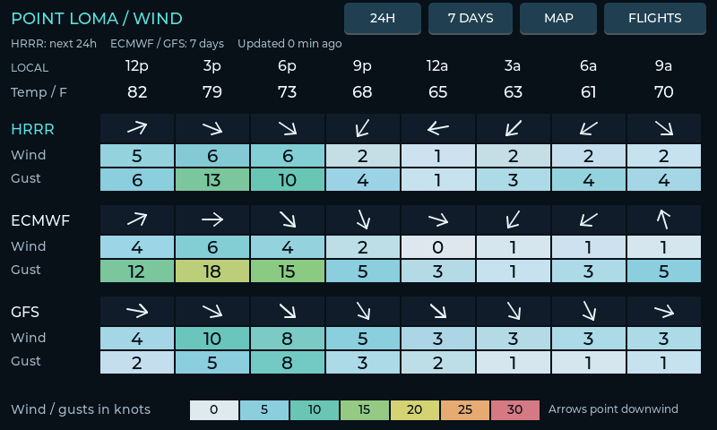
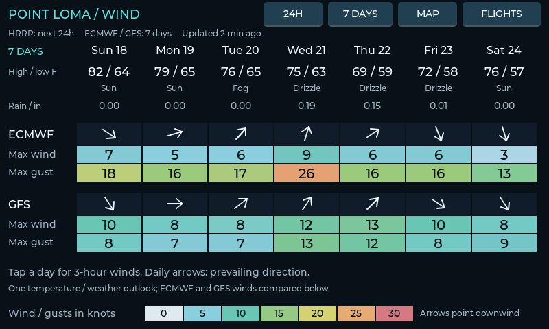

# ESP32 Flight Radar and Weather

A standalone flight tracker and weather display for the **Waveshare ESP32-S3-Touch-LCD-7 Rev 1.2**. Connect it to 2.4 GHz Wi-Fi and it shows nearby aircraft, scaled airport runways, wind forecasts, and animated satellite/radar imagery. No companion computer or ADS-B receiver is required.

## Hardware

| Part | Tested configuration |
| --- | --- |
| Board | Waveshare ESP32-S3-Touch-LCD-7, Rev 1.2, touch version |
| Processor | ESP32-S3, dual-core 32-bit Xtensa LX7 at 240 MHz |
| Display | 7-inch IPS RGB LCD, 800 x 480, RGB565 |
| Touch | Capacitive touch, GT911 controller |
| Memory | 16 MB flash, 8 MB Octal PSRAM |
| Connection | 2.4 GHz Wi-Fi; USB for flashing and optional configuration |
| Power | USB-C 5 V; use a stable supply and a data-capable cable for flashing |

See [Waveshare's hardware documentation](https://docs.waveshare.com/ESP32-S3-Touch-LCD-7). This configuration has not been tested on the 7B, 7C, or non-touch models. The firmware uses the board library's pin mapping, a 13 MHz RGB clock, and bounce buffers with PSRAM XIP support.

## What it displays

- Flight number, airline/logo, estimated origin and destination when available, altitude in feet, ground speed in mph, aircraft type, registration, and distance.
- Nearest aircraft selected automatically; tap a different plane to hold its information, then tap NEAREST to resume.
- Full rectangular radar with faint coastline and real runway geometry. Default 10-mile radius; touch zoom through 2.5, 5, 10, 20, and 40 statute miles. Aircraft remain visible outside the distance circle in the corners.
- 33 Southern California / northern Baja airports with 58 runways. Small airports become dots and codes; crowded labels are suppressed.
- Thirteen airline marks bundled in flash, with proportional antialiased sizing. Other marks load on demand when available. [Asset sources and ownership](docs/airline-logos.md).
- One temperature row and 3-hour wind forecasts: HRRR near term, ECMWF IFS and GFS Global for the longer outlook. Wind and gusts use knots with a fixed 0-30 kt color scale; arrows point downwind.
- Seven-day forecast and six-frame observed IR or visible satellite/radar animation, with zoom controls. The map uses a 640 x 320 image scaled to 800 x 400.

The device starts on the flight page and stays there until you choose another page. There is no automatic page cycling.





The screenshots show the original prototype's regional title. The public build uses general San Diego defaults. Coastline/runway assets and the configured time zone are regional; changing the center does not automatically install map geometry for another region.

## Build on Windows

Install [Arduino CLI](https://arduino.github.io/arduino-cli/latest/installation/) and Git, clone this repository, then run from its root:

```powershell
.\setup.ps1 -Cli 'C:\path\to\arduino-cli.exe'
.\firmware\SanDiegoFlightRadar\build.ps1
```

Setup installs pinned dependencies into this repository's ignored `work/` directory: Arduino ESP32 core 3.2.0, ESP32_Display_Panel 1.0.4, ESP32_IO_Expander 1.1.1, esp-lib-utils 0.2.3, LVGL 8.4.0, and ArduinoJson 7.4.2. It applies the verified Espressif **3.2.0-h PSRAM-XIP SDK**. The ordinary SDK can crash during flash/NVS writes while RGB bounce buffers are active; the code rejects a non-XIP build.

The SDK archive hash is `3d6a0ca36c644b1ad1b3b1c405423c7e2fcd947ae8bd2a733d54289c7d540b07`. Setup preserves the original SDK in a sibling `.standard` directory. It does not flash hardware. A clean rebuild after SDK changes is available with `build.ps1 -Clean`.

The build uses 16 MB flash, OPI PSRAM, 240 MHz CPU, hardware USB CDC, and the `app3M_fat9M_16MB` partition layout. Personal binaries and local settings are ignored by Git.

## First installation

The first installation changes the firmware and partition layout. Replace COM6 below with your board's port. Back up the original 16 MB flash before installing; keep the backup private because it may contain settings.

```powershell
$tool = '.\work\arduino-data\packages\esp32\tools\esptool_py\4.9.dev3\esptool.exe'
& $tool --chip esp32s3 --port COM6 --baud 921600 read_flash 0 0x1000000 .\work\original-device.bin
# Continue only if the read succeeds and the backup is 16,777,216 bytes.
& $tool --chip esp32s3 --port COM6 --baud 921600 write_flash 0 .\firmware\SanDiegoFlightRadar\SanDiegoFlightRadar.merged.bin
```

The public default contains no Wi-Fi credentials. On first boot it opens USB setup, without creating a hotspot or web page. Open `firmware/SanDiegoFlightRadar/Flight Radar Setup.cmd` on Windows, select the serial port, and enter your own SSID, password, and latitude/longitude. The settings are saved atomically in NVS. Passwords are never echoed in serial responses.

Alternatively copy `wifi_defaults.example.h` to the ignored `wifi_defaults.h`, fill in your values, and set `REVISION` to 1 before building. Keep this revision unchanged during later GUI updates. The default time zone is Pacific; change `configTzTime` in `app.cpp` for other regions.

## Later updates retain Wi-Fi settings

```powershell
.\firmware\SanDiegoFlightRadar\build.ps1
.\firmware\SanDiegoFlightRadar\update.ps1 -Port COM6 -Flash
```

The updater verifies binary hashes and the existing partition table, backs up NVS, then writes only the application at `0x10000`. It stops before writing if the partition layout differs or the backup fails. NVS, bootloader, partition table, and filesystem are outside the write. Do not use the merged image or erase flash for routine updates. Keep ignored NVS backups private.

## Data and limits

Aircraft positions refresh about every ten seconds with retry backoff. Stale targets are removed; the nearest 256 aircraft are retained. Large temporary buffers and filtered aircraft JSON use PSRAM. Secure HTTP uses the ESP32 certificate bundle and requires a valid network time.

Origin/destination data comes from a callsign database, not aircraft ADS-B broadcasts, and may be missing or outdated. Implausible routes are rejected; remaining routes are labeled estimates. A geometric check cannot prove that a route is current. A commercial current-flight API is a planned optional improvement.

The 40-mile maximum keeps response sizes manageable. A larger experimental regional request was truncated on the device even though the host computer could download it; that range is not enabled. Weather frames retry failed downloads and retain successful frames. Coastline and runway projections are cached in PSRAM and recomputed only when center or zoom changes, avoiding expensive geographic calculations during every redraw.

- [ADSB.lol](https://www.adsb.lol/docs/open-data/api/): live positions; ODbL.
- [ADSBdb](https://www.adsbdb.com/): callsign routes and carrier metadata.
- [Open-Meteo](https://open-meteo.com/en/docs): HRRR, ECMWF and GFS forecasts. Provider wind/gust conventions differ; values are preserved.
- [NOAA nowCOAST](https://nowcoast.noaa.gov/): observed satellite and radar imagery, not forecast animation.
- [NOAA coastline](https://gis.ngdc.noaa.gov/arcgis/rest/services/EMAG2v3/MapServer/1): generalized local geometry.
- [OurAirports](https://ourairports.com/data/): regional airport/runway data, public domain.
- [Windy meteogram](https://community.windy.com/topic/14827/how-to-read-meteogram): visual design reference; this project does not retrieve Windy data.

Use provider services within their current terms and rate limits. This is an informational hobby display, not an aviation navigation instrument.

## Diagnostics

Serial is 921600 baud with newline-terminated commands. `STATUS` reports connection, aircraft, and memory; `WEATHER` reports model/image state. Send `PERF` twice, at least one second apart, to measure the intervening idle-task runtime and estimate each core's busy percentage; it also reports memory low-water marks. These scheduler measurements are diagnostic estimates, not cycle-exact profiling. `RADAR ZOOM+` and `RADAR ZOOM-` exercise touch zoom. `NEAREST` restores automatic selection. `SETTINGS` returns SSID/coordinates without the password. `PAGE FLIGHTS`, `PAGE WEATHER`, `PAGE WIND`, and `PAGE WEEK` change pages. `SCREENSHOT` returns an 800 x 480 RGB565 framebuffer. Distance/bearing and route plausibility checks run at boot.

## Measured performance

Live flight-page samples on the tested Rev 1.2 board after caching map geometry:

| Radar radius | Core 0 busy | Core 1 busy | Combined busy | Sample |
| --- | ---: | ---: | ---: | ---: |
| 10 miles | 1.3% | 33.4% | 17.4% | 28 seconds |
| 40 miles | 1.4% | 37.6% | 19.5% | 39 seconds |

The 40-mile sample tracked 61 aircraft. Runtime free memory was about 140-143 KB internal RAM and 4.8 MiB PSRAM on the flight page; the observed internal-heap low-water mark was about 83 KB. The application occupies about 59% of its 3 MiB partition. Before caching, the busy core measured about 88% in live samples. Aircraft counts and network activity vary, so these are diagnostic snapshots, not controlled benchmarks or weather-animation stress tests.

## Follow-up list

- [ ] Obtain an API account with a free allowance for current flight origin/destination data. FlightAware AeroAPI Personal currently includes $5/month of query usage, with excess usage billed; confirm terms at signup.
- [ ] Add route caching, bounded result pages, and a persistent monthly request budget before enabling paid-capable requests. Prioritize the selected aircraft and stop at the device budget; other clients can still consume account allowance.
- [ ] Validate current-flight matching, including reused callsigns and actual SAN arrivals.
- [ ] Extend performance sampling to sustained mixed flight/weather animation and longest UI/network delays.

[FlightAware pricing](https://www.flightaware.com/commercial/aeroapi/). [TheFlightWall FAQ](https://theflightwall.com/pages/faq) says its product price includes core data access from several partners; it does not disclose the partners or their fees. No paid API key is included or enabled here.

## License and attribution

Original project code is MIT licensed. The included Espressif LVGL port retains its Apache-2.0 notices and [license](firmware/SanDiegoFlightRadar/Espressif-LICENSE.txt); the LVGL configuration is accompanied by the [LVGL MIT license](firmware/SanDiegoFlightRadar/LVGL-LICENSE.txt). Airline marks and external data retain their own ownership and terms; the code license does not grant rights to them.
